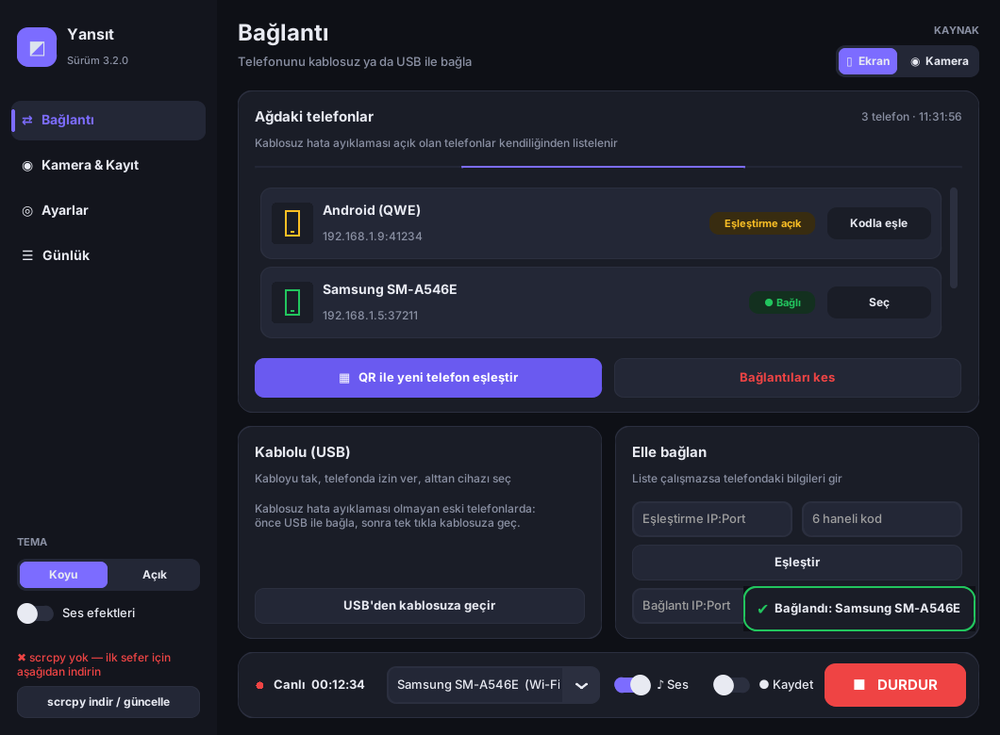
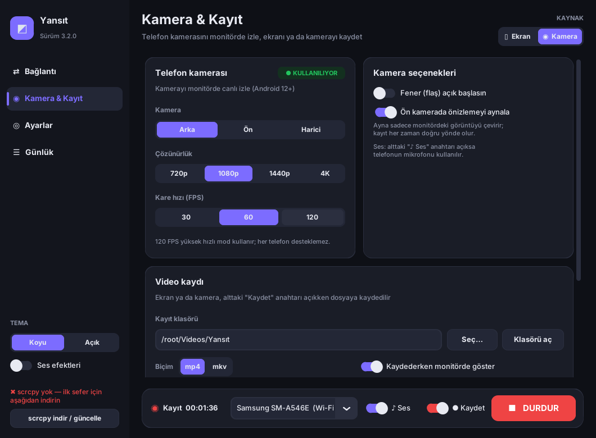
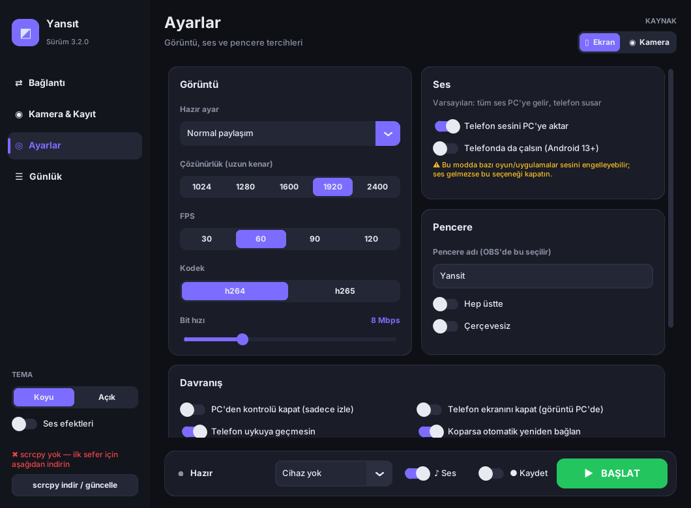
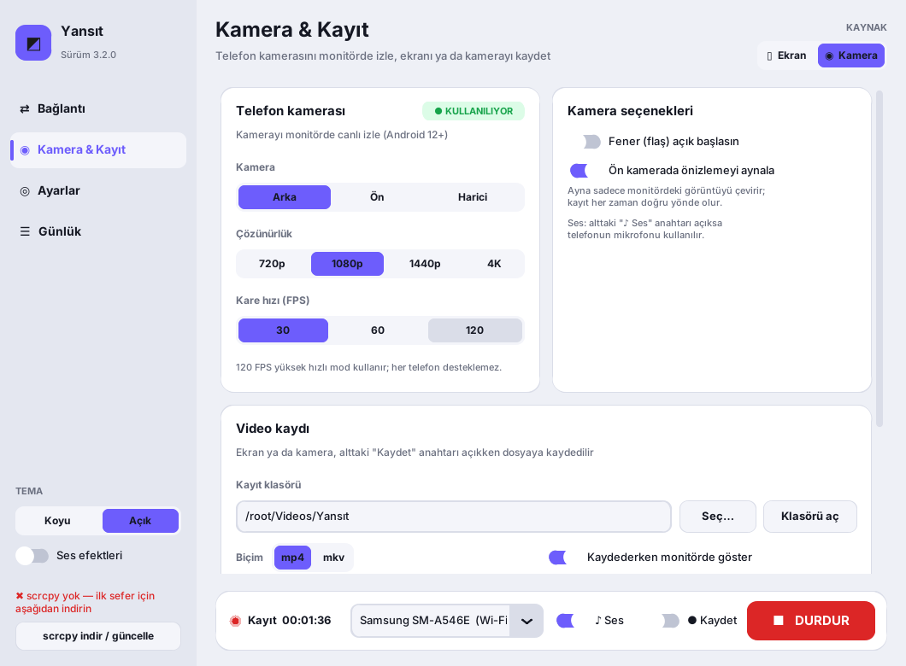

<div align="center">

# ◩ Yansıt

**Android telefonunun ekranını, kamerasını ve sesini bilgisayara yansıt — istersen kaydet.**
Arkadaşına ekran göstermek, PC'den telefonu kullanmak ya da OBS ile oyun yayını açmak için.
**Windows** ve **Linux** (Fedora, Ubuntu, Arch…) destekler.

[](https://github.com/Mehmetsndl/yansit/releases/latest)
[](https://github.com/Mehmetsndl/yansit/releases)
[](LICENSE)

### [⬇ İndir — Windows & Linux](https://github.com/Mehmetsndl/yansit/releases/latest)



</div>

## Özellikler

- **Kolay kurulum:** Windows'ta `Yansit.exe`'yi indirip çalıştırman yeterli. Linux'ta tek komutla uygulama menüsüne eklenir. İkisinde de Python gerekmez.
- **Kablosuz bağlantı:** Ağdaki telefonlar kendiliğinden listelenir, çift tıklayıp bağlanırsın.
- **QR ile eşleştirme:** Telefonla QR kodu okut, eşleşme ve bağlantı kendiliğinden tamamlanır.
- **USB desteği:** Kabloyla bağlanabilir, eski telefonlarda tek tıkla kablosuza geçebilirsin.
- **Ses aktarımı:** Telefonun sesi PC'den çıkar. Android sürümüne göre en uygun yöntem seçilir; bir yöntem çalışmazsa sıradakine geçilir.
- **Telefon kamerası:** Arka, ön ya da harici kamerayı monitörde canlı izle; 4K'ya kadar çözünürlük, 120 FPS'e kadar kare hızı, fener ve mikrofon sesi desteklenir (Android 12+).
- **Video kaydı:** Ekranı ya da kamerayı tek anahtarla mp4/mkv olarak kaydet. Kaydederken görüntüyü monitörde izleyebilir ya da pencere açmadan arka planda kaydedebilirsin.
- **Sanal webcam (Linux):** Telefon kamerasını OBS, Zoom veya Discord'da webcam olarak kullanabilirsin.
- **PC'den kontrol:** Fare ve klavyeyle telefonu kullanabilir, panoyu paylaşabilir, dosyayı pencereye sürükleyip telefona atabilirsin.
- **OBS yayını için hazır ayarlar:** Kablolu, kablosuz ve zayıf Wi-Fi seçenekleri var. Pencere adı sabit kaldığı için OBS kaynağı her seferinde tekrar seçilmeden bulunur.
- **Otomatik yeniden bağlanma:** Wi-Fi kısa süre koparsa yayın kendiliğinden geri gelir.
- **Modern arayüz:** Koyu ve açık tema, animasyonlar, mekanik ses efektleri (istersen kapatabilirsin).
- **Güncelleme bildirimi:** Yeni sürüm çıkınca uygulama haber verir.

<table><tr>
<td></td>
<td></td>
</tr><tr>
<td></td>
<td></td>
</tr></table>

## Kurulum

### Windows
1. [Son sürümden](https://github.com/Mehmetsndl/yansit/releases/latest) `Yansit.exe`'yi indir ve boş bir klasöre koy.
2. Çalıştır. İlk açılışta sol alttaki **scrcpy indir** butonuna bas. Bu bir kere yapılır, yaklaşık 10 MB iner.
3. Windows "bilinmeyen yayıncı" uyarısı verirse **Ek bilgi → Yine de çalıştır** de.

### Linux (Fedora, Ubuntu, Arch…)
[Son sürümden](https://github.com/Mehmetsndl/yansit/releases/latest) `Yansit-vX.Y.Z-linux-x86_64.tar.gz` dosyasını indir, sonra:
```bash
tar xzf Yansit-*-linux-x86_64.tar.gz
cd Yansit-*-linux-x86_64
./install.sh
```
Yansıt artık uygulama menüsünde. Terminalden `yansit` komutuyla da açılır. İlk açılışta sol alttaki **scrcpy indir** butonuna bas; adb de bu paketle birlikte gelir.

**USB ile bağlanacaksan** (Fedora):
```bash
sudo dnf install android-tools
```
Bu paket USB izinlerini (udev kurallarını) da getirir. Kurduktan sonra kabloyu çıkarıp tak. Uygulamada telefonun yanında "USB izni yok" yazıyorsa sebebi budur.

<details>
<summary>Linux notları</summary>

- **Kaldırmak için:** `./install.sh --kaldir`
- Ayarlar `~/.config/yansit`, indirilen scrcpy `~/.local/share/yansit` klasöründe durur.
- Sisteme kurulu scrcpy'yi kullanmak istersen (`dnf copr enable zeno/scrcpy && dnf install scrcpy`), uygulama onu da bulur.
- **Ağdaki telefonlar listesi boşsa:** Fedora Workstation'ın varsayılan güvenlik duvarı mDNS'e izin verir. Fedora Server veya farklı bir bölge kullanıyorsan: `sudo firewall-cmd --permanent --add-service=mdns && sudo firewall-cmd --reload`
- **OBS (Wayland):** Pencere Yakalama yerine **Ekran Yakalama (PipeWire)** kaynağını kullan ve açılan pencerede "Yansit" penceresini seç.
</details>

<details>
<summary>Kaynak koddan çalıştırma</summary>

```bash
git clone https://github.com/Mehmetsndl/yansit
cd yansit
./install.sh          # Linux: bağımlılıkları kurar, menüye ekler
# ya da doğrudan:
pip install -r requirements.txt && python3 yansit.py
```
Windows'ta `Baslat.bat` aynı işi yapar. Kendi exe'ni oluşturmak için `ExeYap.bat` dosyasını kullan.
</details>

## Telefonu hazırlama (bir kere)

1. **Ayarlar → Telefon hakkında → Yapım numarası** satırına 7 kez dokun. Geliştirici seçenekleri açılır.
2. **Geliştirici seçenekleri** içinde **USB hata ayıklama** ve/veya **Kablosuz hata ayıklama** seçeneğini aç.
3. Xiaomi/POCO telefonlarda **USB hata ayıklama (Güvenlik ayarları)** seçeneği de açık olmalı, yoksa PC'den kontrol çalışmaz.

## Kullanım

**Kablosuz (Android 11+):** Telefon ve PC aynı Wi-Fi ağında olmalı.
1. İlk sefer: **QR ile yeni telefon eşleştir** → telefonda *Kablosuz hata ayıklama → Cihazı QR koduyla eşle* → kodu okut.
2. Sonraki seferler: telefonda Kablosuz hata ayıklamayı aç, listede telefonuna çift tıkla, sonra **Başlat**'a bas.

**Kablolu:** Kabloyu tak, telefonda **izin ver**'e bas, alttan cihazı seç, **Başlat**'a bas.

### Kamera ve kayıt
1. Sağ üstteki **Kaynak** seçicisinden **Kamera**'yı seç. Kamera, çözünürlük ve FPS ayarları **Kamera & Kayıt** sayfasında.
2. Kaydetmek için alt çubuktaki **Kaydet** anahtarını aç ve **Başlat**'a bas. Görüntü monitörde açılır, aynı anda kaydedilir.
3. **Durdur**'a bastığında dosya düzgünce kapatılır ve kayıt klasörüne (varsayılan: *Videolar/Yansıt*) kaydedilir. Klasörü **Kamera & Kayıt → Klasörü aç** ile açabilirsin.

Kayıt ekran yansıtmada da çalışır: Kaynak **Ekran**'dayken **Kaydet**'i açarsan oyun ya da ekran kaydı alırsın.

<details><summary><b>Linux: kamerayı webcam olarak kullanma (v4l2loopback)</b></summary>

Fedora'da [RPM Fusion](https://rpmfusion.org/Configuration) etkinken bir kez:
```bash
sudo dnf install akmod-v4l2loopback
sudo modprobe v4l2loopback video_nr=10 card_label=Yansit exclusive_caps=1
```
Ardından **Kamera & Kayıt → Sanal webcam'e gönder**'i aç. OBS, Zoom ve Discord'da kamera olarak **Yansit**'i seç.
</details>

### PC'den kontrol kısayolları
| Kısayol | İşlev | Kısayol | İşlev |
|---|---|---|---|
| Sağ tık | Geri | Orta tık | Ana ekran |
| Alt+S | Son uygulamalar | Alt+F | Tam ekran |
| Alt+R | Döndür | Alt+O | Telefon ekranını kapat/aç |
| Ctrl+C / V | Pano paylaşımı | Sürükle-bırak | Dosyayı telefona gönder |

### OBS ile yayın
- Ayarlar sayfasında **Oyun yayını · Kablolu** veya **Kablosuz** hazır ayarını seç.
- OBS'de **Kaynak ekle → Pencere Yakalama → `[scrcpy.exe]: Yansit`** seç, yakalama yöntemi olarak *Windows 10 (1903 ve üzeri)* kullan.
- Ses için: **Uygulama Ses Yakalama → scrcpy.exe**.
- Yansıtma penceresini simge durumuna küçültme, yoksa OBS'de siyah görünür. Pencerenin başka pencerelerin arkasında kalması sorun değil.

## Sık sorulanlar

<details><summary><b>Ses gelmiyor</b></summary>

- Alt çubuktaki **Sesi aktar** anahtarı açık mı? Ses aktarımı **Android 11 veya üstünü** gerektirir.
- Varsayılan modda telefonun bütün sesi PC'ye gelir ve telefonun hoparlörü susar. Bu normaldir.
- **Telefonda da çalsın** modu (Android 13+) açıksa bazı oyun ve uygulamalar sesini vermeyebilir. Bu seçeneği kapat.
- Android 11'de başlatırken telefonun kilidi açık olmalı.
</details>

<details><summary><b>Telefon listede görünmüyor</b></summary>

- Telefon ve PC aynı ağda mı? Misafir ağları ve bazı okul/yurt ağları cihazların birbirini görmesini engeller. Bu durumda kabloyla ya da **Elle bağlan** bölümünden bağlan.
- Windows Güvenlik Duvarı `adb.exe` için izin sorarsa **Özel ağlar**'a izin ver.
</details>

<details><summary><b>Görüntü takılıyor</b></summary>

**Zayıf Wi-Fi** hazır ayarını seç, 5 GHz Wi-Fi kullan ya da kabloyla bağlan.
</details>

Sorun yaşarsan **Günlük** sayfasından kaydı kopyalayıp bir [issue](https://github.com/Mehmetsndl/yansit/issues) aç.

## Sürüm takibi

Sürümler [Anlamsal Sürümleme](https://semver.org/lang/tr/) (`ANA.ARA.YAMA`) kuralına uyar. Tüm değişiklikler [CHANGELOG.md](CHANGELOG.md) dosyasında yazılıdır. Uygulama açılışta GitHub'daki son sürümü kontrol eder; yeni sürüm varsa sol altta bildirim çıkar.

**Yeni sürüm yayınlama (geliştirici için):**
1. `yansit.py` içindeki `__version__` değerini artır, örneğin `3.1.0`.
2. `CHANGELOG.md` dosyasına `## [3.1.0] - TARİH` başlıklı bir bölüm ekle.
3. Commit'le ve etiketi gönder:
   ```bash
   git commit -am "Sürüm 3.1.0"
   git tag v3.1.0
   git push && git push --tags
   ```
4. GitHub Actions Windows (`Yansit.exe`) ve Linux (`.tar.gz`) paketlerini derler, sürüm notlarıyla birlikte bir **Release** yayınlar.

## Teşekkür

Yansıt, ekran yansıtma için Genymobile'ın açık kaynaklı [scrcpy](https://github.com/Genymobile/scrcpy) projesini (Apache 2.0) kullanır. scrcpy, uygulamanın içinden resmi GitHub sürümlerinden indirilir. Yansıt bu aracın üstüne kurulmuş Türkçe bir arayüzdür.

## Lisans

[MIT](LICENSE)
